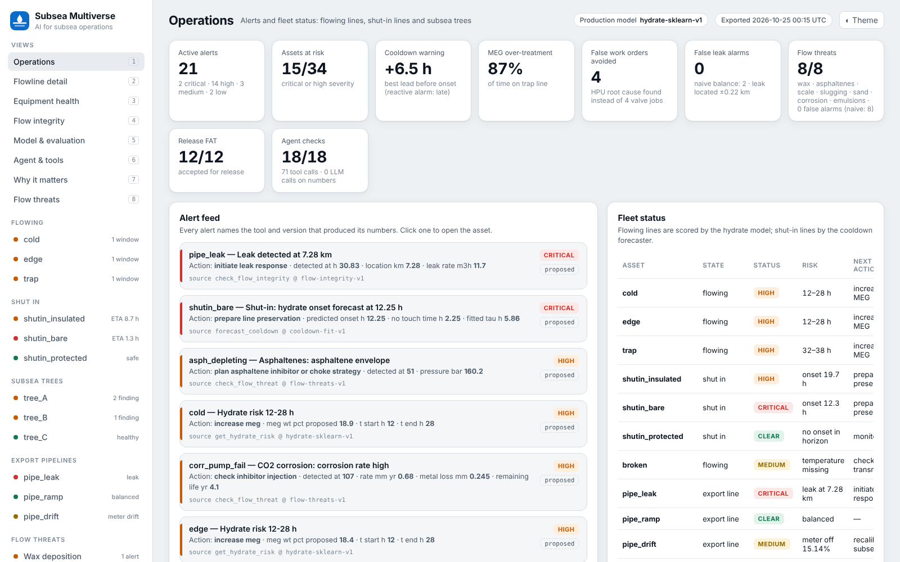
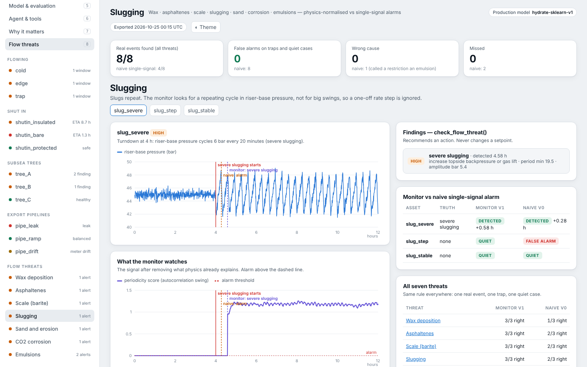
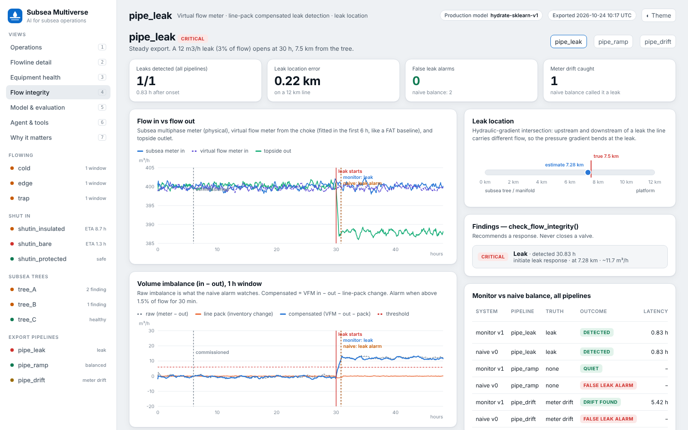

# Subsea Multiverse — AI for subsea operations

An evaluated AI copilot for **flow assurance** and **subsea equipment health**: hydrate risk, shutdown cooldown, MEG dosing, wax, asphaltenes, scale, slugging, sand and erosion, CO₂ corrosion, emulsions, tree valve condition monitoring and pipeline leak detection. One tool-using agent sits on top, and every release passes a FAT-style acceptance procedure.

Every feature is scored against a naive baseline on cases built to fool it. Physics and small trained models produce the numbers. A language model may explain, but it never produces a number. Every recommendation leaves the system as `proposed` for an engineer to approve, and nothing commands equipment.

## Try it

**[Explore the dashboard](https://subsea-multiverse.netlify.app/)** to click through the scenarios, alerts, evaluation and agent. Everything in it is synthetic, with known answer keys.

**[Run the hydrate check](https://hydrate-check.onrender.com)** to upload a well's pressure and temperature history and get a plain-language verdict. On real Petrobras 3W wells (CC BY 4.0) it flagged 5 of 5 usable hydrate events and raised 0 false alarms in 4,680 h of normal and other-event data.

The hydrate check can take a minute to wake on the first visit. The two pages link to each other.

## Results

All scenarios are synthetic with known answer keys (see [Limits](#limits)).

| Feature | Trap it has to survive | Subsea Multiverse | Naive baseline |
|---|---|---|---|
| **Hydrate risk** | Choke closure raises dP but is not a hydrate | Mean IoU **1.000**, 0 false hours on the trap | dP-only rule: IoU 0.810, **8 false hours** |
| **Shutdown cooldown** (no-touch time) | Insulated vs bare line after an unplanned shut-in | Warns **6.6 h** and **1.3 h** before onset; silent on the protected line | Reactive alarm fires **5.0 h** and **1.7 h late** |
| **MEG dosing advisor** | A line injecting 20 wt% "to be safe" | Finds it **over-treated 87%** of the time; flags two lines unprotected for a shut-in | Current injection taken as correct |
| **Flow threats** (wax, asphaltenes, scale, slugging, sand / erosion, CO₂ corrosion, emulsions) | A trap per threat: rate change, temperature step, planned pressure step, inhibited line, well below bubble point, a restriction that looks like an emulsion | **8/8** real events found, **0** false alarms, **0** wrong cause; asphaltene risk warned **27 days** ahead | Single-signal alarms: 4/8 found, **8 false alarms**, 1 wrong cause |
| **Pipeline leak detection** | Rate ramp and a drifting subsea meter | Leak found **0.83 h** after onset, located within **0.22 km** on a 12 km line | Mass balance: **2 false leak alarms** |
| **Valve health vs FAT signature** | HPU supply drops 40%, so every valve looks slow | Both real faults flagged early; **one HPU root cause**, 0 false work orders | **4 false valve work orders** |
| **Robustness** (30 noise seeds) | Same exams, new noise | Flow threats 240/240, leak 30/30, 0 false alarms | Flow threats: 232 false alarms |
| **Agent** | Invented or borrowed numbers in the handover | **18/18** behaviour checks; 71 tool calls for 34 assets, 0 language-model calls on numbers | — |
| **Release acceptance test** | A release that breaks any of the above | **12/12 PASS** | — |

## How it works

1. **Check the data.** Bad or missing sensor data stops the analysis for that asset. It is reported, not guessed.
2. **Call only the tools that fit.** Each asset gets at most three tool calls: a flowing line gets hydrate risk and MEG dosing, a shut-in line the cooldown forecaster, an export pipeline leak detection, a tree valve health, and so on.
3. **Report and hand over.** Findings go to an engineer as proposals. The handover is checked so that every number in it traces back to a tool result.

Each monitor first removes what physics already explains (flow rate, temperature, water cut, a planned operation), then alarms on what is left. That is why it stays quiet on the traps that fool single-signal alarms. It runs on an ordinary CPU, with no GPU.

## Code

The source code is private. I'm happy to walk through it or share access with hiring teams on request: reach me on [LinkedIn](https://www.linkedin.com/in/abedamilola).

## Limits

- **Synthetic data.** Scenarios and answer keys are invented so that failure modes can be measured. No real SCADA data has been used yet.
- **Teaching physics.** Simplified relationships stand in for full transient simulation, PVT and lab studies. Real work uses tools such as OLGA or LedaFlow, wax and asphaltene lab data, scale prediction software and industry standards for erosion, corrosion and leak detection.
- **Product shape, not physics fidelity.** This shows how an operations copilot should be evaluated, gated and released. It does not replace flow assurance software.
- **No affiliation.** It does not claim hands-on use of any commercial product.

## Author

**Damilola Abe**, Subsea Engineer (M.S. Subsea Engineering, University of Houston). SPS / SURF commissioning, FAT / SIT, flow assurance and subsea digital.
[LinkedIn](https://www.linkedin.com/in/abedamilola)
